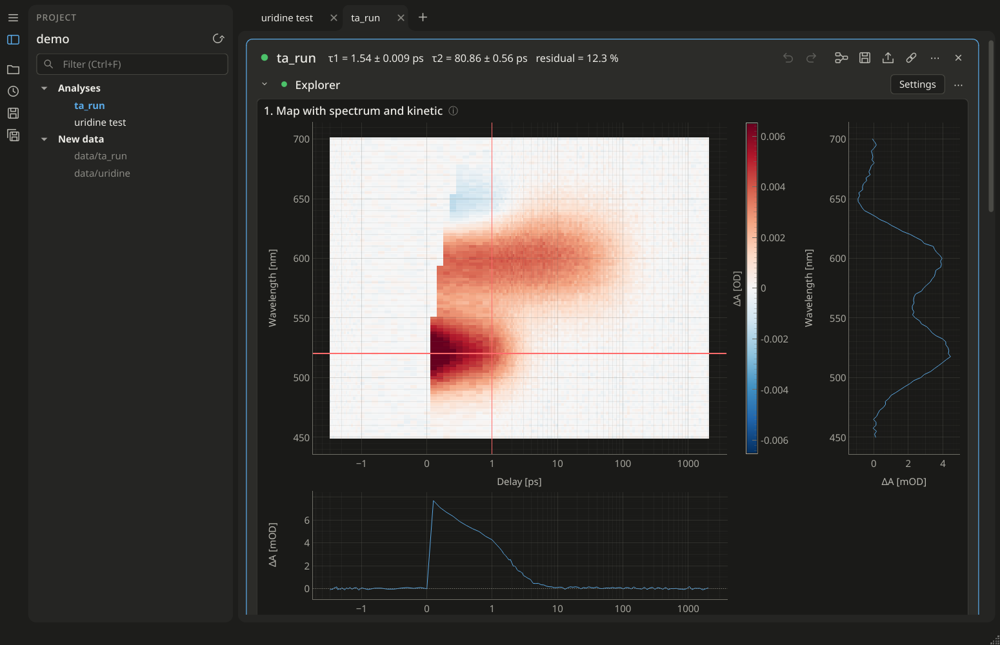
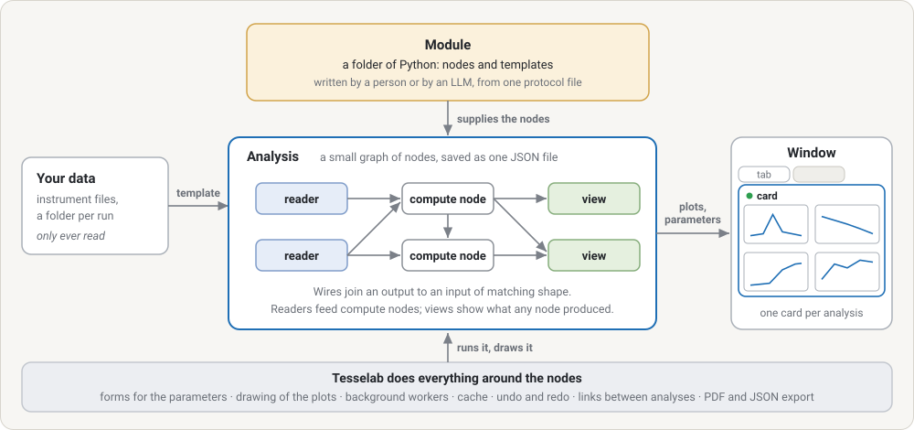
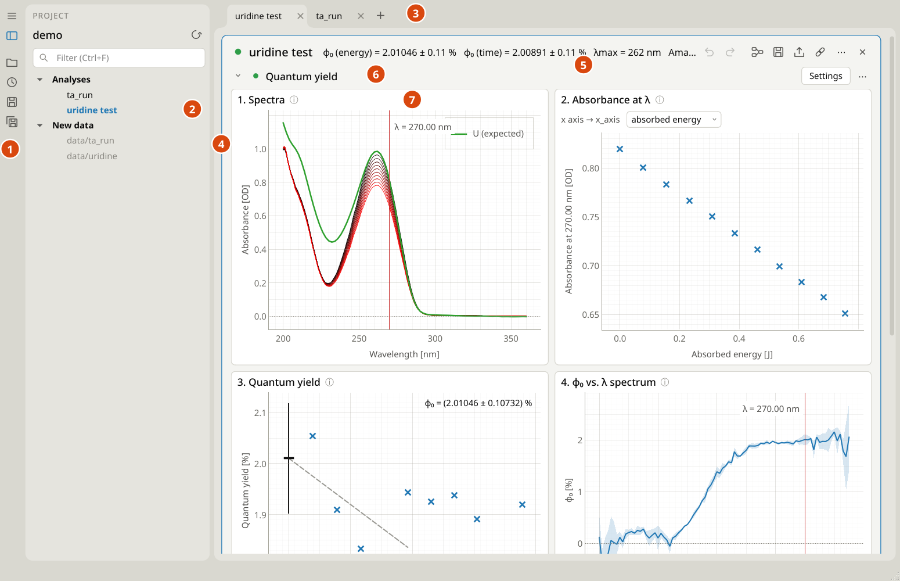
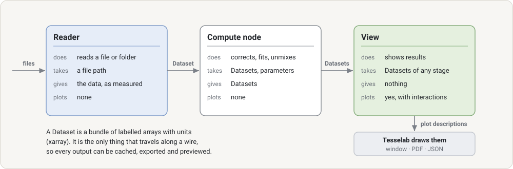
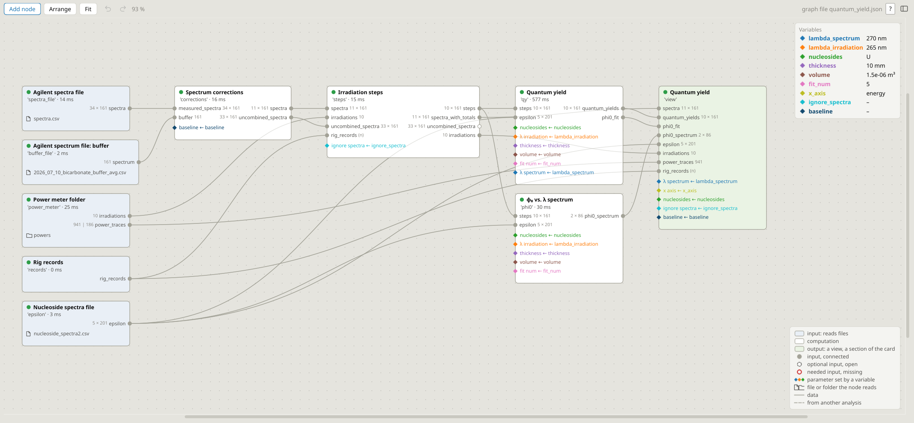
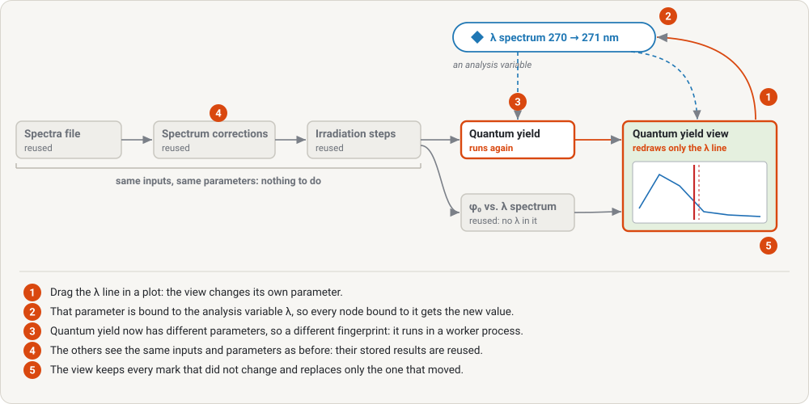
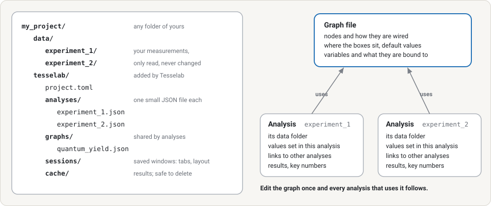
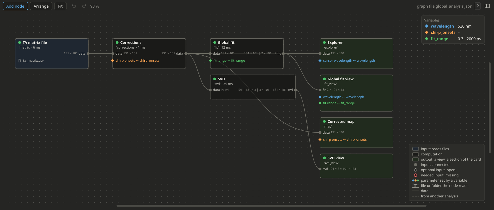

# Tesselab
> **Work in progress, published for testing only.** Tesselab is at version 0.1. Features are missing, things break, and nothing is stable: the module protocol, the file formats and the look of the window can all change without notice. It has been used on Linux only. Please do not rely on it for results you need.

> **No license yet.** The terms are still being clarified with my institute. Until a license is added, all rights are reserved: the code is public to read and to try out, not yet to reuse or redistribute.

> **Install.** `pipx install tesselab` (or `pip install tesselab`). This is a pre-release; the examples are not part of the installed package: see "Try it". Straight from GitHub: `pipx install git+https://github.com/jonathanbollig/tesselab.git`.

A desktop viewer for scientific data in which every analysis is a small graph of nodes that you can see, rewire and save. You open a folder of measurements, get an analysis with its plots, and then drag a cursor, change a parameter or rewire a node: only what depends on the change is computed again.


*A transient absorption analysis of synthetic sample data: a map with a crosshair, and the spectrum and the kinetic at the crosshair. Tesselab draws it; the nodes behind it come from a module.*
## The idea in one picture

- **Data stays data.** You point Tesselab at the folders of your measurements. It only reads them: everything it makes goes into its own `tesselab/` folder, or where you export it.
- **An analysis is a graph.** Reading the files, correcting, fitting and showing the results are separate nodes, wired together. The graph is not hidden in a script: you can look at it, rewire it, and it is saved as one small JSON file.
- **Modules bring the science, Tesselab brings the rest.** A module is a folder of Python that supplies nodes for one kind of data. A module author writes plain numpy and never touches Qt or plotting code. The window, the forms for the parameters, the drawing, background processes, cache, undo, links and export are Tesselab's.
## Words used here
| Word | What it is |
|---|---|
| **Project** | A folder of your data. Tesselab adds a `tesselab/` folder to it for what you make: analyses, graphs, saved windows. |
| **Explorer** | The sidebar of the window: the project's analyses, and under "New data" the data folders that a module's template recognizes. |
| **Module** | A folder of Python that supplies nodes and templates for one kind of data (an instrument, a method). |
| **Node** | One step of an analysis. There are three kinds: **readers** read files, **compute nodes** compute, **views** show results. |
| **Template** | A ready-made analysis for a kind of data. Double-click a data folder under "New data" and its template makes an analysis for it. |
| **Analysis** | A graph of nodes with the values of their parameters, saved as one small JSON file. The thing you open, save, compare and export. |
| **Graph** | The wiring of an analysis: nodes, connections, variables. Analyses of the same kind share one graph file. You edit it in the graph window. |
| **Variable** | A named value, such as a wavelength, that parameters of several nodes are bound to. Drag the cursor in a plot and every node bound to it follows. |
| **Card** | An analysis in the window: a header with its name, key results and buttons, then one section per view with its plots and parameters. |
| **Tab** | A page of the window. It holds one or more cards, for example two experiments next to each other. |
| **Link** | Cards of a tab can be linked (the chain button): zoom, cursors and open sections move together, to compare experiments. A node's input can also be linked to an output of another analysis. |
## The window

*A quantum yield analysis of a UV irradiation experiment (the sample of the UV example module).*
1. **Rail**: the menu (☰), fold the explorer, open a project, recent projects, save, save all.
2. **Explorer**: the project's analyses, and the data folders that can become one.
3. **Tabs**: each holds cards. An analysis can be open in several tabs; they share one state and one undo history.
4. **Card**: one analysis. The one with the blue frame is the active card: Save, Undo and Export act on it.
5. **Card header**: status dot, name, key results, then undo, redo, graph, save, export and link.
6. **View**: a section of the card. Readers and compute nodes sit folded below the views, under "Details".
7. **Plot**: drawn from a description; cursors, picks and ranges in it set parameters of the nodes (drag the red λ line and the quantum yield follows).
## Nodes and the graph

Three kinds of node keep apart what a script usually mixes up. **Readers** only read, **compute nodes** only compute, and only **views** have plots. A node says what data it needs and what it gives; Tesselab wires an output to an input where the shape of the data fits, and offers only connections that make sense.


*The graph window of the same analysis. Blue boxes read files, white boxes compute, the green box is the view that becomes the card's section. Dots on the left of a box are its inputs, dots on the right its outputs, with the size of the data beside them. Colored rows are parameters bound to a variable; the variables are listed at the top right.*

You edit the analysis here: drag a wire from an output to an input, drop it on empty space to search for nodes that accept it, add or remove nodes, bind a parameter to a variable. Everything has a right-click menu, and every step can be undone.
## Design philosophy
- **Simple and visible.** The structure of an analysis should be something you can look at, not something you have to read out of code. Few concepts, plain files, no database.
- **Everything a node returns is data.** Outputs are labelled arrays with units (xarray Datasets), and plots are descriptions of plots, not widgets. That is what lets Tesselab run nodes in background processes, cache them, export every plot as PDF and as JSON, and one day draw with another library, without any module changing.
- **Wires by shape, not by agreement.** An input says "a matrix and its two axes" or "absorbance by wavelength", and any output that fits can be connected, names first. Nodes from different modules combine without knowing each other.
- **Fast enough to drag.** A viewer is for trying things, so a cursor drag has to feel instant. Every result is stored under a fingerprint of everything it depends on, including the content of its inputs, so only what changed runs again (first picture below).
- **Many experiments, one graph.** The graph belongs to the kind of experiment, the sample details to each analysis (second picture below).
- **Checkable modules.** Nodes are pure functions of their inputs and parameters. `tesselab check` runs a module on its sample data, tests every output and renders every plot to a picture to look at. The UV example reproduces the numbers of the author's earlier program bit for bit.
- **Written by people or by an LLM.** One protocol file, [AGENTS.md](https://github.com/jonathanbollig/tesselab/blob/main/src/tesselab/AGENTS.md), is enough to write a module; `tesselab new module` starts from one that already passes the check.
- **Follows your files.** The window follows changes on disk (Modules → Follow changes on disk, on unless you switch it off): when a file an open analysis reads changes (a measurement still being written, a corrected CSV), that analysis is computed again; when a module's code changes (you or an LLM edit it), the module is reloaded and its nodes run again. Only what a change concerns runs again, and the status bar says what happened. Without it, Modules → Reload modules (Ctrl+Shift+R) does the same by hand.




## What is included
| Module | What it does |
|---|---|
| `table` (built in) | A CSV table of series. |
| `chemometrics` (built in) | SVD and MCR-ALS of any matrix. |
| `transient_absorption` (example) | Pump-probe ΔA matrices: corrections (background, chirp, time zero), a map with spectrum and kinetic at a crosshair, a global fit with exponentials. Comes with a synthetic sample. |
| `uv_photochemistry` (example) | Quantum yields of stepwise UV irradiation from UV-Vis spectra and power meter traces. It carries a copy of the five files it needs from the author's own analysis package `kufner_uv_analysis` (private), so it runs on its own; the author checks its numbers against the original, bit for bit. Comes with the sample of one experiment. |


*The graph of the transient absorption analysis: a reader, corrections, a global fit and an SVD, and four views. Three variables tie nodes together: the wavelength (explorer and fit view), the chirp onsets (corrections and map) and the fit range (fit and fit view).*
## Try it
Python 3.11 or newer. The examples and their sample data are in this repository, so start from a clone:
```
git clone https://github.com/jonathanbollig/tesselab.git
cd tesselab
pip install -e .
tesselab init demo
mkdir demo/data
cp -r examples/modules/transient_absorption/sample/ta_run demo/data/
tesselab --modules examples/modules demo
```
Under "New data" in the explorer, double-click `data/ta_run`: the template makes an analysis. Drag the crosshair, open the graph with the graph button in the card header (Ctrl+G), change a parameter, press Ctrl+Z. Right-click anything for its menu.

| Command | What |
|---|---|
| `tesselab [path]` | The window: a project folder, an analysis file or a saved window. `tesselab --help` lists everything, `tesselab --version` the version. |
| `tesselab check <module folder>` | Checks a module on its sample data and renders its plots to `<module>/check/`. |
| `tesselab new module <folder>` | A minimal module that already passes the check, to start from. |
| `tesselab export <analysis.json> [-o out.pdf]` | PDF of every plot and a JSON of the plotted data, without a window. |
| `tesselab init <folder>` | Makes a folder a project. |
| `tesselab modules` | Lists the modules Tesselab finds. |

`--modules <folder>` (before the command) adds a folder of modules. Tesselab also finds modules in the project (`tesselab/modules/`, it asks before running them), in your user folder (`~/.local/share/tesselab/modules/` on Linux), among its own, in installed packages, and in folders named in `TESSELAB_MODULE_PATH`.
## Status
- **Works:** the window with tabs, cards, undo and redo, saving, linked cards, PDF and JSON export; the graph window; shared graph files; the three kinds of node; the four modules above; the command line.
- **Missing or rough:** plot settings (colormap, which spectra are shown) and plots in a window of their own; connecting several sources to one input in the window; the look has been checked on one Linux desktop only. Windows and macOS are prepared but untested.
- **Not frozen:** the module protocol (`api = 1`) is frozen only once a third module, written from AGENTS.md alone, works; so far there are two examples. Until then anything may change.
## Documentation and tests
- [AGENTS.md](https://github.com/jonathanbollig/tesselab/blob/main/src/tesselab/AGENTS.md): the module protocol, for people and LLMs; copied into every new module.
- [CLAUDE.md](https://github.com/jonathanbollig/tesselab/blob/main/CLAUDE.md): how the code is organized, the decisions and their reasons, how to work on it.
- `pytest` runs the tests: the core, the window (offscreen) and the examples. It takes several minutes; the comparison with the original `kufner_uv_analysis` is skipped where that package is not installed.
- `docs/images/` holds the pictures of this page; `tools/readme_images.py` and `tools/readme_diagrams.py` make them again.
## License
None yet, see the note at the top.
